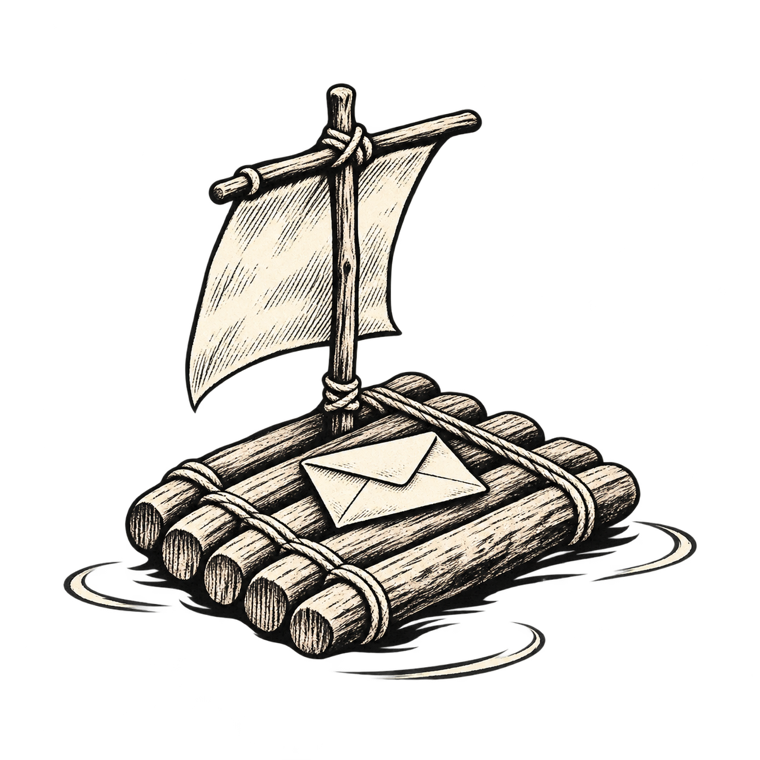

<p align="center">
  
</p>

<h1 align="center">Raft Lark Bridge</h1>

<p align="center">
  <em>Bring selected Lark chats to Raft. Reply as yourself.</em><br>
  把指定的飞书会话交给 Raft Agent，以你的身份原路回复。
</p>

<p align="center">
  <code>Node.js 22.13+</code> · <code>lark-cli 1.0.100</code> · <code>macOS LaunchAgent</code>
</p>

## Documentation · 使用文档

<details>
<summary><strong>简体中文</strong> · 安装与使用</summary>

把本机登录的 `lark-cli` 账号绑定到 Raft Agent。可以选择指定单聊、指定群聊，或只转发指定群里 @ 你的消息。一个桥接服务可以管理多条绑定。

### 快速开始

**所需环境** · Node.js 22.13+、已登录的 `lark-cli` profile，以及管理员可以创建 External Agent 的 Raft 服务器。桥接使用 `lark-cli` 1.0.100 的命令和输出格式。

1. 在 Raft 打开 **Members → Connect an external agent → Build your own**，创建一个桥接身份，例如 `@lark-bridge`，留好 `sk_agent_…` 凭证供向导使用。桥接身份会通过私聊把消息交给你已有的 Agent。
2. 在项目目录运行下面的命令。`setup` 会隐藏凭证输入，并引导你选择 Lark profile、目标 Agent 和会话。可以从最近的私聊里选、按群名搜索，或直接输入会话 ID（`oc_…`）。预览命中的消息后保存绑定。

   ```bash
   npm ci
   node src/cli.js setup
   node src/cli.js doctor
   node src/cli.js run
   ```

3. 用另一个飞书账号在刚绑定的测试会话发条新消息。消息进入 Raft 后，Agent 可以在这条消息的线程里按以下格式回复。

   ```text
   /lark-reply
   这里是要发回飞书的正式答复。
   ```

每条转发消息都附有这项回复约定。桥接会把目标 Agent 的第一条带标记答复作为纯文本发回飞书。进度更新留在 Raft。

> [!TIP]
> `doctor` 检查身份和读取权限，不发送消息。请在测试会话中验证你的飞书账号也能以本人身份回复。

### 管理绑定

再次运行 `node src/cli.js setup` 就能添加另一条绑定。命令中的 `<绑定>` 可以用绑定名称，也可以用 `status` 显示的 ID。

| 命令 | 用途 |
| --- | --- |
| `node src/cli.js status` | 查看绑定、队列和近期错误 |
| `node src/cli.js preview <绑定>` | 预览命中的消息，无需转发 |
| `node src/cli.js pause <绑定>` | 暂停绑定，已经提交的请求仍可能完成 |
| `node src/cli.js resume <绑定>` | 继续处理待办消息，从保存的位置补读 |
| `node src/cli.js unbind <绑定>` | 解除绑定 |
| `node src/cli.js run --once` | 执行一轮实际转发和回复 |

同一飞书登录身份与会话的组合只允许一条绑定。更改规则时，先解除旧绑定，再运行 `setup`。配置、Raft 凭证和 SQLite 数据库默认存放在 `~/.raft-lark-bridge`。可以用 `--data-dir <目录>` 管理独立的配置，例如为另一台 Raft 服务器建立桥接。

### macOS 后台运行

先停止前台进程，再用运行 `lark-cli` 的同一个 macOS 账号安装并启动用户级 LaunchAgent。

```bash
node src/cli.js service install
```

用 `service stop`、`service start` 和 `service remove` 管理后台服务。状态和错误代码写入数据目录中的 `bridge.log`。绑定修改在下一轮生效。移动安装位置后，重新运行 `service install`。需要前台运行时使用 `node src/cli.js run`。

### 消息投递与数据

- **收消息。** 默认每 20 秒轮询飞书搜索，查询时间窗口会重叠，并按消息 ID 去重。新绑定从保存时开始处理。新消息查询的速度和覆盖范围取决于飞书搜索索引。
- **回复和重试。** 桥接先把回复保存到 SQLite，再推进 Raft 收件箱游标。重试会复用幂等键。标记为「待核对」的回复，需要先检查 Raft 线程和飞书原会话，再手动补发。
- **身份和可见范围。** 每条绑定都会在发送前核对飞书应用和登录用户。Lark 凭证由 `lark-cli` 管理，Raft 桥接凭证保存在本机仅当前用户可读的文件中。命中的消息会进入 Raft 私聊，参与的 Agent、其创建者以及服务器所有者或管理员可以查看。 [Raft 私聊可见性](https://docs.raft.build/features/messaging/channels/)

### 分享和开发

可以把项目目录或本地 npm 安装包发给同事。同事在自己的电脑上用本人的 Lark 登录和独立的 Raft External Agent 凭证运行 `setup`。绑定配置和运行数据也保留在各自的电脑上。

```bash
npm test
npm pack --dry-run
```

测试使用模拟的 Lark 和 Raft 服务，覆盖多身份、倒序回复、重启、身份变化、分页、重试和去重。本地试用期间包保留私有设置。公开项目时再选择许可证和发布渠道。

[飞书消息搜索](https://github.com/larksuite/cli/blob/main/skills/lark-im/references/lark-im-messages-search.md) · [飞书原消息回复](https://github.com/larksuite/cli/blob/main/skills/lark-im/references/lark-im-messages-reply.md) · [Raft External Agent 接入](https://docs.raft.build/developers/sdk/external-agents/)

[↑ 返回语言选择](#documentation--使用文档)

</details>

<details>
<summary><strong>English</strong> · Setup and usage</summary>

Bind a signed-in `lark-cli` profile to a Raft agent. Choose a specific DM, a group chat, or only messages that @mention you in a specific group. One bridge can manage multiple bindings.

### Quick start

**Requirements** · Node.js 22.13+, a signed-in `lark-cli` profile, and a Raft server where an admin can create an External Agent. The bridge uses the command and output formats of `lark-cli` 1.0.100.

1. In Raft, open **Members → Connect an external agent → Build your own**. Create a bridge identity, for example `@lark-bridge`, and keep the `sk_agent_…` credential for setup. This identity delivers messages to your existing agents by DM.
2. From the project directory, run the commands below. `setup` prompts for the bridge credential with hidden input and lets you pick your Lark profile, target agent, and chat. Pick a recent DM, search by group name, or enter a chat ID (`oc_…`). Review the matching messages and save the binding.

   ```bash
   npm ci
   node src/cli.js setup
   node src/cli.js doctor
   node src/cli.js run
   ```

3. Send a new message from another Lark account in the bound test chat. When it arrives in Raft, the agent can use the format below to reply in the message's thread.

   ```text
   /lark-reply
   This is the reply to send to Lark.
   ```

The bridge includes these instructions with each forwarded message. It sends the first marked reply from the bound agent as plain text. Progress updates stay in Raft.

> [!TIP]
> `doctor` checks identity and read access without sending a message. Use a test chat to verify that your Lark account can also reply under its own name.

### Manage bindings

Run `node src/cli.js setup` again to add a binding. Use a binding name or the ID shown by `status` for the commands that take `<binding>`.

| Command | What it does |
| --- | --- |
| `node src/cli.js status` | Show bindings, queue counts, and recent errors |
| `node src/cli.js preview <binding>` | Preview matching messages without forwarding |
| `node src/cli.js pause <binding>` | Pause a binding. Requests already submitted can still finish |
| `node src/cli.js resume <binding>` | Resume pending work and catch up from the saved search position |
| `node src/cli.js unbind <binding>` | Remove a binding |
| `node src/cli.js run --once` | Run one cycle with forwarding and replies enabled |

Each Lark login and chat pair can have one binding. To change its rule, remove the existing binding and run `setup` again. Configuration, the Raft credential, and the SQLite database live in `~/.raft-lark-bridge` by default. Use `--data-dir <directory>` to manage an independent configuration, such as a bridge for a different Raft server.

### Run in the background on macOS

Stop the foreground process, then install and start the user-level LaunchAgent under the same macOS account that runs `lark-cli`.

```bash
node src/cli.js service install
```

Use `service stop`, `service start`, or `service remove` to manage it. The service writes status and error codes to `bridge.log` in the data directory. Binding changes take effect on the next cycle. If you move the installation, run `service install` again. For foreground use, run `node src/cli.js run`.

### Delivery and data

- **Incoming messages.** The bridge polls Lark search every 20 seconds by default, overlaps search windows, and deduplicates by message ID. A new binding starts when saved. Search indexing affects how quickly and how completely new messages are found.
- **Replies and retries.** Replies are saved in SQLite before the Raft inbox cursor advances. Retries reuse the same idempotency key. A reply marked for review needs a manual check in the Raft thread and the original Lark chat before you resend it.
- **Identity and visibility.** Each binding checks the selected Lark application and user before sending. Lark credentials stay managed by `lark-cli`, and the Raft bridge credential is stored locally with user-only permissions. Matching messages enter a Raft DM that the participating agents, their creators, and server owners or admins can access. [Raft DM visibility](https://docs.raft.build/features/messaging/channels/)

### Share and develop

To invite a teammate to try it, share the project folder or a local npm package. Each teammate runs `setup` on their own machine with their own Lark login and Raft External Agent credential. Binding configuration and runtime data stay on that machine.

```bash
npm test
npm pack --dry-run
```

Tests use simulated Lark and Raft services to cover multiple accounts, out-of-order replies, restarts, identity changes, pagination, retries, and deduplication. The package is marked private during the local trial. Choose a license and publishing channel before making the project public.

[Lark message search](https://github.com/larksuite/cli/blob/main/skills/lark-im/references/lark-im-messages-search.md) · [Lark message replies](https://github.com/larksuite/cli/blob/main/skills/lark-im/references/lark-im-messages-reply.md) · [Raft External Agents](https://docs.raft.build/developers/sdk/external-agents/)

[↑ Back to languages](#documentation--使用文档)

</details>
