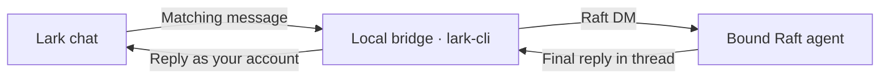

<h1 align="center">Raft Lark Bridge</h1>

<p align="center">Connect your Lark conversations to Raft agents with the account you already use.</p>

<p align="center"><strong>English</strong> · <a href="./README.zh-CN.md">简体中文</a></p>

---

Bind a local `lark-cli` profile to a Raft agent. Choose a direct chat, a group chat, or messages that @mention you in a specific group. The agent can reply to the original Lark message using that same signed-in account. A single bridge can manage multiple bindings.



<p align="center"><a href="#quick-start">Quick start</a> · <a href="#manage-bindings">Manage bindings</a> · <a href="#run-in-the-background-on-macos">Run in the background</a></p>

## Quick start

**Requirements** · Node.js 22.13+, a signed-in `lark-cli` profile, and a Raft server where an admin can create an External Agent. The bridge uses the command and output formats of `lark-cli` 1.0.100.

1. In Raft, open **Members → Connect an external agent → Build your own**. Create a bridge identity, for example `@lark-bridge`, and keep the `sk_agent_…` credential for setup. This identity delivers messages to your existing agents by DM.
2. From the project directory, run the commands below. `setup` prompts for the bridge credential with hidden input and lets you pick your Lark profile, target agent, and chat. Pick a recent DM, search by group name, or enter a chat ID (`oc_…`). Review the matching messages and save the binding.

   ```bash
   npm ci
   node src/cli.js setup
   node src/cli.js doctor
   node src/cli.js run
   ```

3. Send a new message from another Lark account in the bound test chat. When it arrives in Raft, the agent can use the format below to reply in the message's thread.

   ```text
   /lark-reply
   This is the reply to send to Lark.
   ```

The bridge includes these instructions with each forwarded message. It sends the first marked reply from the bound agent as plain text. Progress updates stay in Raft.

> [!TIP]
> `doctor` checks identity and read access without sending a message. Use a test chat to verify that your Lark account can also reply under its own name.

## Manage bindings

Run `node src/cli.js setup` again to add a binding. Use a binding name or the ID shown by `status` for the commands that take `<binding>`.

| Command | What it does |
| --- | --- |
| `node src/cli.js status` | Show bindings, queue counts, and recent errors |
| `node src/cli.js preview <binding>` | Preview matching messages without forwarding |
| `node src/cli.js pause <binding>` | Pause a binding. Requests already submitted can still finish |
| `node src/cli.js resume <binding>` | Resume pending work and catch up from the saved search position |
| `node src/cli.js unbind <binding>` | Remove a binding |
| `node src/cli.js run --once` | Run one cycle with forwarding and replies enabled |

Each Lark login and chat pair can have one binding. To change its rule, remove the existing binding and run `setup` again. Configuration, the Raft credential, and the SQLite database live in `~/.raft-lark-bridge` by default. Use `--data-dir <directory>` to manage an independent configuration, such as a bridge for a different Raft server.

## Run in the background on macOS

Stop the foreground process, then install and start the user-level LaunchAgent under the same macOS account that runs `lark-cli`.

```bash
node src/cli.js service install
```

Use `service stop`, `service start`, or `service remove` to manage it. The service writes status and error codes to `bridge.log` in the data directory. Binding changes take effect on the next cycle. If you move the installation, run `service install` again. For foreground use, run `node src/cli.js run`.

## Delivery and data

- **Incoming messages.** The bridge polls Lark search every 20 seconds by default, overlaps search windows, and deduplicates by message ID. A new binding starts when saved. Search indexing affects how quickly and how completely new messages are found.
- **Replies and retries.** Replies are saved in SQLite before the Raft inbox cursor advances. Retries reuse the same idempotency key. A reply marked for review needs a manual check in the Raft thread and the original Lark chat before you resend it.
- **Identity and visibility.** Each binding checks the selected Lark application and user before sending. Lark credentials stay managed by `lark-cli`, and the Raft bridge credential is stored locally with user-only permissions. Matching messages enter a Raft DM that the participating agents, their creators, and server owners or admins can access. [Raft DM visibility](https://docs.raft.build/features/messaging/channels/)

## Share and develop

To invite a teammate to try it, share the project folder or a local npm package. Each teammate runs `setup` on their own machine with their own Lark login and Raft External Agent credential. Binding configuration and runtime data stay on that machine.

```bash
npm test
npm pack --dry-run
```

Tests use simulated Lark and Raft services to cover multiple accounts, out-of-order replies, restarts, identity changes, pagination, retries, and deduplication. The package is marked private during the local trial. Choose a license and publishing channel before making the project public.

[Lark message search](https://github.com/larksuite/cli/blob/main/skills/lark-im/references/lark-im-messages-search.md) · [Lark message replies](https://github.com/larksuite/cli/blob/main/skills/lark-im/references/lark-im-messages-reply.md) · [Raft External Agents](https://docs.raft.build/developers/sdk/external-agents/)
